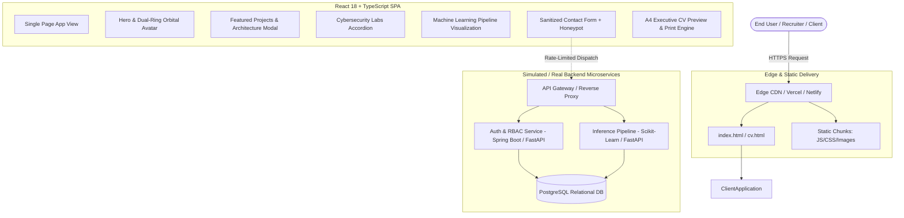

# 06 — System Architecture

## 1. High-Level System Architecture Diagram

---

## 2. Component Communication Patterns
- <strong style="color: #D90429; font-weight: 700;">Unidirectional Data Flow:</strong> Data flows down via props (`ProjectModal`, `OrbitalAvatar`); user interactions bubble up via typed callback functions (`onOpenResume`, `onClose`).
- <strong style="color: #D90429; font-weight: 700;">Zero Heavy State Overheads:</strong> The portfolio avoids excessive Redux or Context providers, keeping DOM operations predictable and instantaneous.
- <strong style="color: #D90429; font-weight: 700;">Hardware-Accelerated Compositing:</strong> All animations (`rotateRing`, `scrollRtoL`) animate exclusively on `transform` and `opacity` properties to prevent DOM layout recalculations.

